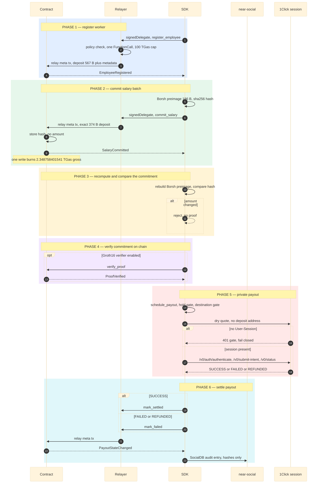

# subrosa

Private payroll on NEAR. Employers register workers, publish commitment hashes, and settle via **Confidential Intents**. Public state hides amounts and payer-payee links.

The contract records commitment hashes, payout state, audit holds, and auditor roles. It never holds funds. Settlement runs off chain on the 1Click Confidential Intents API and reports via `mark_settled` or `mark_failed`.



## What is built

| Slice | Location | Contents |
| --- | --- | --- |
| Contract | `contract/` (`subrosa-contract`) | Employer/employee registry. Salary commitments. Scheduled payouts. Audit holds. Auditor roles. One global pause. NEP-297 events. Optional Groth16 verifier. Storage-deposit checks on every write |
| SDK | `packages/core/` (`near-subrosa-core`) | Typed contract clients. 1Click Confidential Intents client. Confidential payout and payout-flow orchestration. User-Session client. Auditor CSV export. SocialDB hash-only audit trail. NEP-297 event cursor. Batch resume tokens. Redaction and privacy analysis |
| Relayer | `relayer/` (`near-subrosa-relayer`) | NEP-366 meta transactions: an employer with zero NEAR can register and commit. Employees need no NEAR account |
| Entry points | `scripts/`, `examples/`, `testdata/` | Zero-funds demo, measured numbers, OpenAPI field check, two dry-run examples, pinned 1Click OpenAPI 0.1.10 snapshot |

Contract surface: `new`. Enrolment uses `register_employee`, `update_employee`, and `deactivate_employee`, plus paginated views. `commit_salary` and `batch_commit_salaries` take 1-50 items.

Payouts: `schedule_payout`, `cancel_payout`, `mark_settled`, `mark_failed`, `expire_payout`, `is_payout_due`.

Holds and governance: `create_audit_hold`, `release_audit_hold`, `grant_auditor`, `revoke_auditor`, owner-only `set_pause`, verification keys, and Groth16 `verify_proof`.

Events use NEP-297 standard `subrosa` (`1.0.0`): `EmployeeRegistered`, `EmployeeUpdated`, `SalaryCommitted`, `AuditorChanged`, `PayoutScheduled`, `PayoutStateChanged`, `AuditHoldChanged`, `ProofVerified`.

Flow: register -> commit -> schedule (`PrivatePayoutFlow`) -> hold gate -> destination gate -> commitment check -> quote.
Next: NEP-413 sign -> `/v0/submit-intent` -> poll -> `mark_settled` (`SUCCESS`) or `mark_failed` (`FAILED`/`REFUNDED`).
`PayrollService.processPayment` enforces every gate. Amounts and salts stay in memory and never enter args, logs, or errors.

## Quickstart: do this, see that

Node.js 26.0.0 or newer, then:

```bash
npm install
npm run build
node examples/private-payroll-simulation.ts
```

The example needs network access to `https://1click.chaindefuser.com` and nothing else. No wallet, no API key, no deposit, no transaction. Expected output ends with:

```text
confidential quote: gated=401 User-Session-required; requests validated locally
public quote: dry=true recipientType=INTENTS depositAddress=none signature=present
simulation complete: commitments=1 verified=1 confidential=gated publicDryQuotes=1 fundsMoved=0
```

`node examples/payroll-execution.ts` runs a two-employee batch via dry preflight.
While the User-Session gate holds, it ends with `dry preflight gated: payouts=2/2 validated=local fundsMoved=0`.

## Zero-funds demo

The demo builds the SDK first and needs network access to 1Click and nothing else. `scripts/demo.ts` prints nine stages, then exits non-zero if anything unexpected happens. Three representative lines:

```text
[1/9] config: network=testnet contract=subrosa.testnet oneclick=1click.chaindefuser.com apiKey=none funds=0 session=none
[5/9] confidential-quote: gated=401 User-Session-required; preflight=fail-closed (no key or funds in demo)
[9/9] summary: commitments=3 confidentialDryQuotes=0 publicDryQuotes=1 confidential=gated resumed=1 secretsLeaked=0 fundsMoved=0
```

Stages: config, `/v0/tokens` asset lookup, three commitment hashes, batch check, confidential quote, public dry quote, resume token, redaction, summary.

Without funds, it tests commitment hashes, batch validation, confidential request validation (401 gate), and a public dry quote. It also tests opaque-token batch resume and secret redaction across output. It fails closed on non-dry quotes, deposit addresses in dry quotes, unexpected errors, rejected tokens, or printed secrets.

## Confidential Intents

**Confidential Intents** is the 1Click private shard (`CONFIDENTIAL_INTENTS` for `recipientType`, `depositType`, `refundType`). The SDK keeps these as plain JSON strings so no nested private-intents type crosses the client boundary.

- `OneClickClient` covers all fourteen 1Click paths: `/v0/generate-intent`, `/v0/submit-intent`, `/v0/quote`, `/v0/status`, `/v0/auth/authenticate`, balances, history.
- `confidentiality` picks `public`, `basic`, or `advanced` shielding.
- `ConfidentialPayout` owns quote -> sign -> submit -> poll. It maps `SUCCESS`, `FAILED`, `REFUNDED`, `INCOMPLETE_DEPOSIT`.
- Partner JWT travels only in `X-API-Key`. It never enters a URL, error, or returned object.

No public Confidential Intents testnet exists, so every quote uses `dry: true`. A dry quote checks assets, recipient pair, slippage, deadline, and signature without deposit addresses or funds.

## D20: the User-Session gate

1Click rejects confidential quotes without a User-Session token:

```text
HTTP 401 "User authentication is required for confidential intent quotes"
```

Getting a User-Session requires proving wallet key ownership: sign `intents: []` via NEP-413, then exchange at `/v0/auth/authenticate`. That needs a human wallet key, so zero-credential confidential dry quotes fail today. This is a human gate, not a bug. Demo and examples assert 401 and validate confidential requests locally instead of faking quotes.

Supply `ONECLICK_USER_SESSION` to take the live confidential dry-quote path; invalid tokens fail closed. Dry quotes only: no deposit address, no signature submission, no funds.

## Headline number

One salary commitment costs **374 B = 0.00374 NEAR** of storage and burns **2.348758401541 TGas** gross.
Storage matches `storage_usage` delta at 1e19 yoctoNEAR/byte (`COMMITMENT_RECORD_BYTES`, asserted on chain).
Gas is measured `total_gas_burnt` for one `commit_salary` write. A 50-item batch reserves 0.187 NEAR.

`scripts/numbers.ts` reduces one capture file to the two deltas above. It fails closed if the capture is missing, malformed, or differs from the pinned claim. A valid run ends with `OK: capture matches the pinned claim in NUMBERS.md.`; `--json` writes machine-readable output for diffing. See `NUMBERS.md` for full accounting, the capture command, and rerun proof.

Gas is **gross**: protocol 87 (`RemoveGasRewards`, HSP-027) removed the 30% developer rebate.

## Contract on testnet (optional)

```bash
(cd contract && cargo near build non-reproducible-wasm)
near create-account subrosa.testnet --useFaucet --networkId testnet
near contract deploy subrosa.testnet use-file ./target/near/subrosa_contract.wasm \
  with-init-call new json-args '{"owner":"subrosa.testnet"}' \
  prepaid-gas '100 Tgas' attached-deposit '0 NEAR' network-config testnet sign-with-keychain send
near contract call-function as-read-only subrosa.testnet get_employee_count \
  json-args '{"employer":"subrosa.testnet"}' network-config testnet now
```

Every method that creates a record is `#[payable]`. Attach at least `record_bytes * env::storage_byte_cost()` or the call fails. Fund the contract account for storage staking before the first write.

## Build and test

| Command | Covers | Recorded result |
| --- | --- | --- |
| `cargo check --manifest-path contract/Cargo.toml --target wasm32-unknown-unknown` | contract compiles for wasm | exit 0 |
| `cargo test --manifest-path contract/Cargo.toml` | 46 Rust unit tests, then 4 `near-workspaces` sandbox tests (after the wasm build below) | 46 + 4 passed |
| `npm run typecheck` | SDK typecheck | exit 0 |
| `npm test` | Node test suite (`node --test`) | 199 passed |
| `npm run test:relayer` | relayer suite | 46 passed |
| `npm run check:oneclick` | 1Click OpenAPI fields against the pinned 0.1.10 snapshot | 6 checks passed |
| `npm run demo` | zero-funds demo | 9/9 stages |
| `npm run numbers -- --capture target/numbers/capture.log` | reduces the sandbox capture to the measured gas and storage deltas | 2.348758401541 TGas / 374 B |

Sandbox tests need `cargo near build non-reproducible-wasm` (`target/near/subrosa_contract.wasm` or `SUBROSA_CONTRACT_WASM`) and download nearcore 2.14.0 on first run.

`.env.example` documents runtime vars (`.env` stays git-ignored): `SUBROSA_NETWORK`, `NEAR_RPC_URL`, `SUBROSA_CONTRACT`, `ONECLICK_BASE_URL`, `ONECLICK_API_KEY`, `SUBROSA_DEV_KEY`, `SUBROSA_STORE_PATH`.

Toolchain: Rust >= 1.95 (tested 1.100.0, edition 2024), near-sdk 5.30.2, near-sdk-contract-tools 4.0.0, near-workspaces 0.24.0, cargo-near 0.23.0. Also near-cli-rs 0.31.1, nearcore sandbox 2.14.0, Node.js >= 26.0.0, npm 12.2.1 (`packageManager`).
SDK pins near-api-js 7.5.3, near-social-js 2.0.4, `@hot-labs/near-connect` 0.12.0. Root `overrides` pins ONE `near-kit` 0.20.2. Groth16 fixtures come from snarkjs 0.7.6 (`contract/testdata/groth16/multiplier2/README.md`).

## Limits and out of scope

- **Delegated approver flows.** No `assign`/`get`/`revoke` approval assignment. Every row is owned by the employer that wrote it.
- **Separation of duties (SoD), approval expiry, multi-signature coordination.** No role derivation or policy engine. These stay client-side.
- **5-category pause.** The contract keeps one global pause (`set_pause`, owner-only) that blocks every mutating method.
- **Amendments, archive, reconciliation, disputes, webhooks.** Not ported.
- **On-chain amount reveal or commitment checks.** NEAR state is public. Clients verify commitments off chain. Disclosure uses CSV from `AuditorDisclosureExporter`.
- **Atomic on-chain payout or balance calls.** Settlement is off chain via Confidential Intents. Async outcomes cannot roll back on chain.
- **Companion contracts from origin.** Their license metadata is `NOASSERTION`. They are not copied. `contract/` is clean-room.
- **KYC/sanctions integrations and hosted indexer.** The SDK provides an event cursor and idempotent processor. No indexer service is deployed.
- **Hosted relayer, backend, or UI.** Relayer runs locally on testnet.

## Security limits

- **NEP-413 requires a full-access key.** Intent payloads and backend login challenges are message signatures. A function-call key can never produce one. `Nep413Signer` and `backendAuth` reject it up front with `FULL_ACCESS_KEY_REQUIRED`.
- **Function-call key allowance is not a spend limit.** Receiver, method, and gas allowance bound calls only.
- **Relayer policy.** NEP-366 ignores inner allowance. Relayer enforces one `FunctionCall` (`register_employee`, `commit_salary`, `batch_commit_salaries`), `maxBlockHeight` <= 600 blocks, and 1 NEAR cap.
- **Relayer gas and storage.** Gas caps at 100 TGas (300 TGas batch). Deposits match exact storage.
- **Relayer pays gas and inner storage.** Outer tx uses an NEP-611 gas key (up to 1,024 nonce lanes). Liquid balance pays inner deposits. Fund both.
- **Retained storage deposits.** Contract keeps deposits with no refund path. Attach exact storage: 567 B employee + metadata (<= 256 B).
  Other record sizes: 374 B commitment, 258 B payout + memo, 186 B hold, 73 B proof nullifier.
- **Deposit address is a correlation secret.** `/v0/status` echoes quote responses. Audit trail keeps commitment and intent hashes only. Flow errors are redacted.
- **Async settlement.** `mark_settled` runs on `SUCCESS`. `FAILED`/`REFUNDED` map to `mark_failed`. `INCOMPLETE_DEPOSIT` surfaces without an on-chain write.

## Origin, baseline, and status

<!-- origin-disclosure:start -->
This port starts from MIT-licensed `zkpayroll/zk-payroll-sdk` (https://github.com/zkpayroll/zk-payroll-sdk).
Its `dev` HEAD `a3166417082436901aa2b66618fdaf9c6c08ae17` (1,050 files) was fetched and committed unmodified as `b7bafa51c1262bbe4322391584e3212d26c37b9a`.
Delta to upstream `dev`: https://github.com/zkpayroll/zk-payroll-sdk/compare/a3166417082436901aa2b66618fdaf9c6c08ae17...dev

Origin companion contracts carry `NOASSERTION` license metadata and are excluded. The Rust contract under `contract/` is a clean-room implementation of the documented method surface (see `ATTRIBUTION.md`).
<!-- origin-disclosure:end -->

This repository is production tooling for a port, not a hackathon entry.

## License

MIT. See `LICENSE` (which retains the origin copyright notice) and `ATTRIBUTION.md`.

## Hackathon

Tracks: `privacy`, `realworld`. Development ends 2026-11-14T23:59:00Z (UTC).
